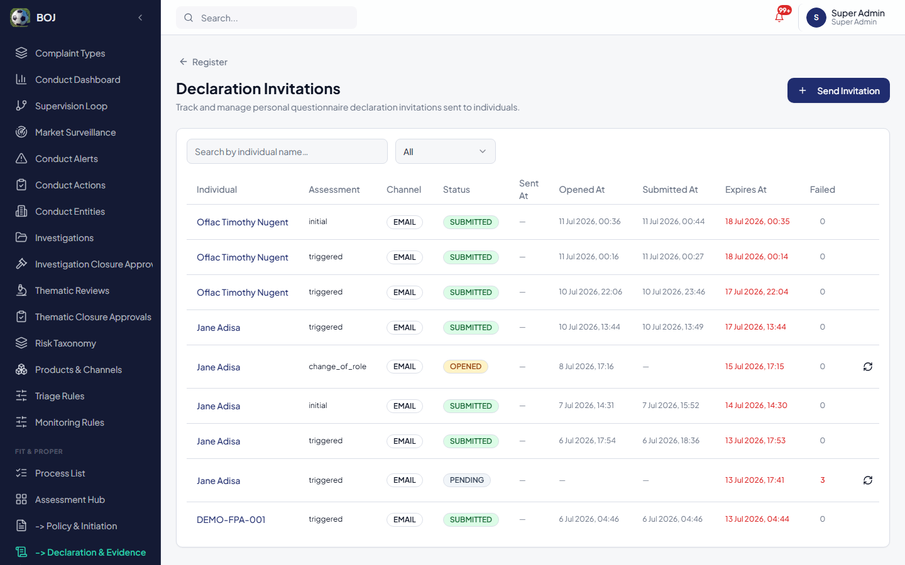
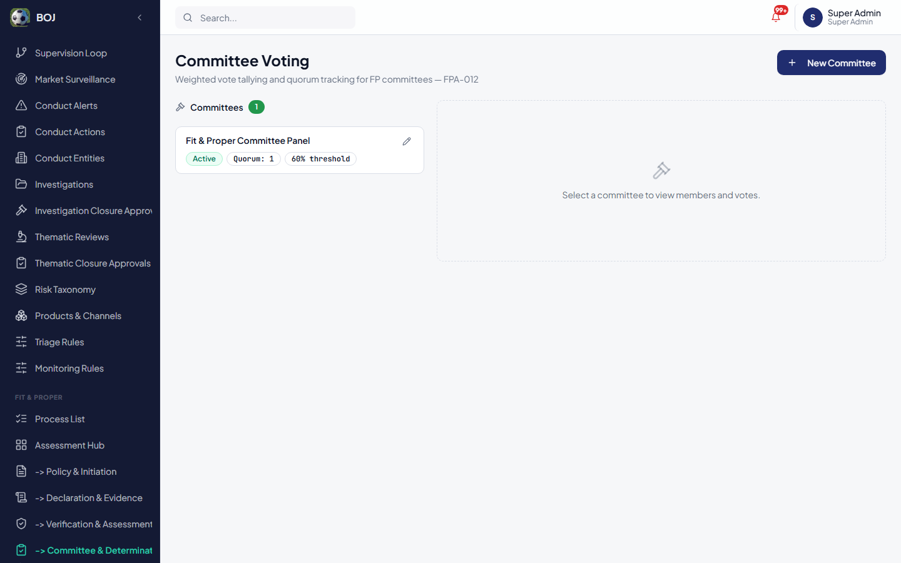
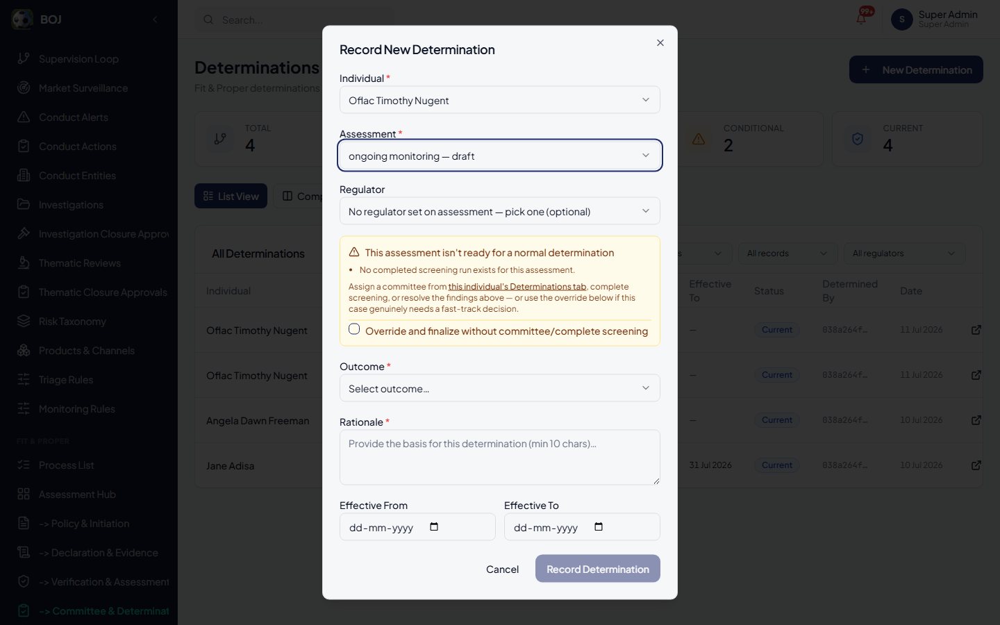
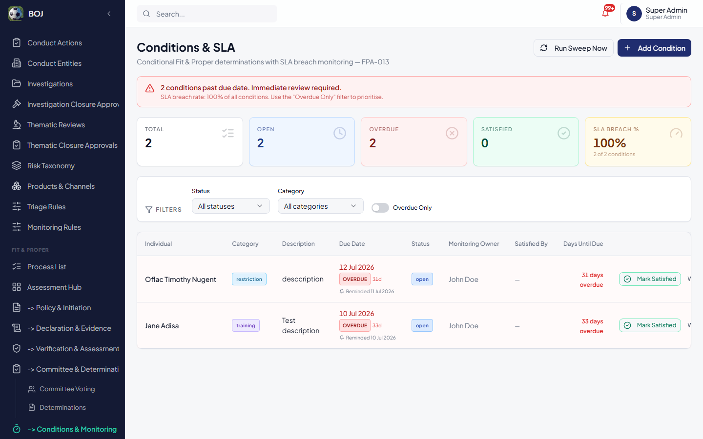
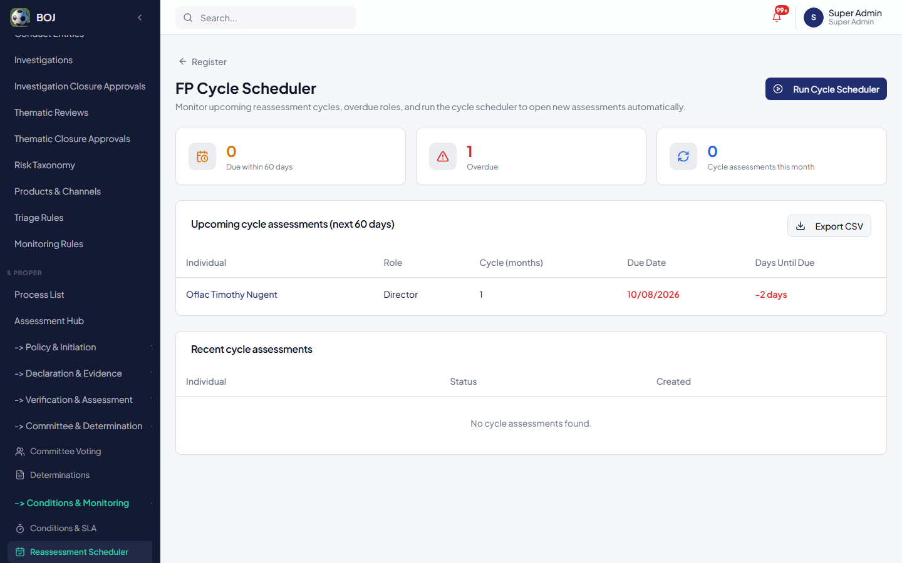
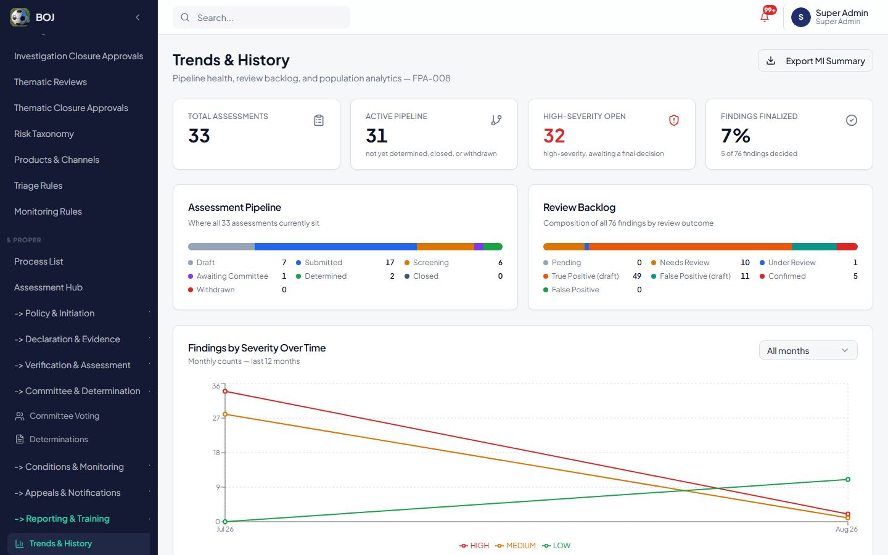
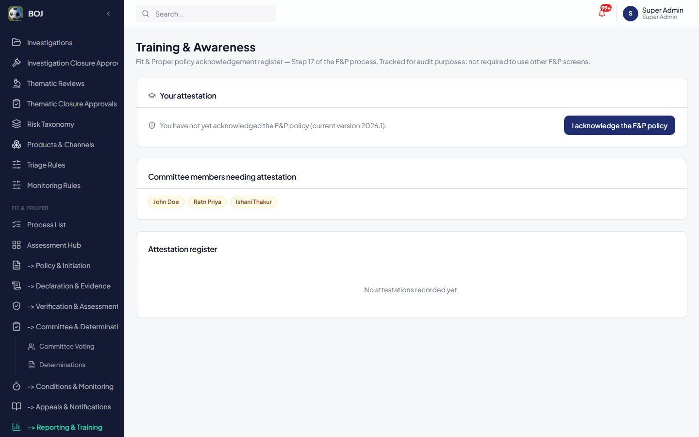
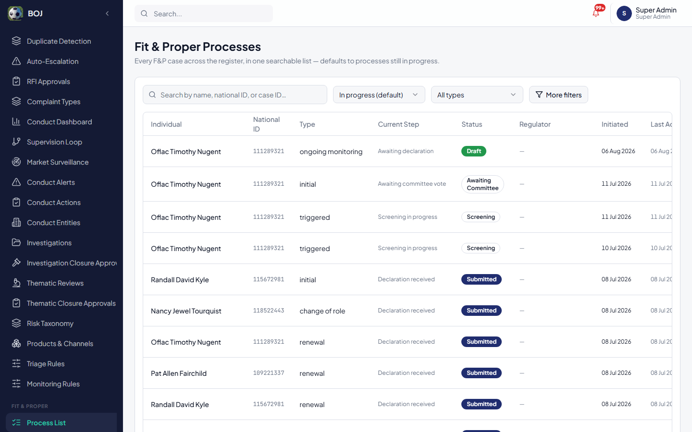

# Fit & Proper Process — Training & Operational Manual

**Audience:** anyone using the Fit & Proper (F&P) module for the first time, with no prior background in fit-and-proper regulation or this application.

**Purpose of this document:** to take you from zero knowledge to being able to run a complete Fit & Proper case, start to finish, on your own — and afterwards, to serve as your day-to-day reference.

**Basis:** every screen, field, button, status, and message described below has been verified directly against the implemented application (`src/pages/fpa/*`, routes under `/fpa/*`, and the underlying database rules that enforce them) as of this writing. Where the real system behaves in a way that a newcomer might not expect, this is called out explicitly rather than smoothed over.

> Screenshot placeholders are marked `[screenshot: ...]`. See the Appendix for how to complete them once a working environment is available.

---

## Table of Contents

**Part 1 — Understanding Fit & Proper** — [1.1](#11-what-is-a-fit--proper-assessment) What it is · [1.2](#12-what-is-actually-being-assessed) What's assessed · [1.3](#13-who-is-involved) Who's involved · [1.4](#14-glossary) Glossary · [1.5](#15-the-17-step-lifecycle-at-a-glance) The 17 steps at a glance · [1.6](#16-how-to-tell-where-a-case-stands) Reading a case's status

**Part 2 — The 17 Steps in Detail** — one subsection per step

**Part 3 — How the Steps Depend on Each Other**

**Part 4 — The Status Lifecycle**

**Part 5 — The Process List Screen**

**Part 6 — Notifications**

**Part 7 — End-to-End Walkthroughs** (normal path + exception paths)

**Part 8 — Troubleshooting & Common Mistakes**

**Part 9 — Roles & Responsibilities**

**Appendix** — capturing screenshots, terminology index

---

# Part 1 — Understanding Fit & Proper

## 1.1 What is a Fit & Proper assessment?

A **Fit & Proper (F&P) assessment** is a formal check that a specific person — someone who is, or is about to become, a director, senior manager, controller, shareholder, or other key person at a regulated entity — is honest, competent, and financially sound enough to be trusted with that position.

**Why it exists:** regulators require this because the people running or controlling a licensed financial entity have influence over depositors' money, policyholders' claims, or the market more broadly. A single dishonest or incompetent key person can cause serious harm. Fit & Proper assessment is the regulator's (or the institution's, acting on the regulator's behalf) mechanism for catching that risk *before* someone takes up a role, and for continuing to watch for it for as long as they hold it.

**What the outcome actually decides:** at the end of an assessment, a formal **determination** is recorded — essentially "yes, this person may hold this role" (**Fit**), "no, they may not" (**Not Fit**), "yes, but only if they meet certain conditions" (**Conditionally Fit**), or "we need more information before deciding" (**Deferred**). This determination has real consequences: it can permit, block, or condition someone's ability to act in a regulated role.

## 1.2 What is actually being assessed?

Every question on the declaration and every check the system runs exists to answer one of these underlying concerns:

| Concern | Plain-English question | Where it's assessed in the system |
|---|---|---|
| **Honesty & integrity** | Has this person ever been dishonest, sanctioned, or involved in serious wrongdoing? | Declaration sections on criminal/regulatory history, disciplinary history, professional conduct; sanctions/PEP/adverse-media screening |
| **Competence** | Do they have the qualifications and experience for this role? | Declaration sections on qualifications, employment history, educational/professional affiliations |
| **Financial soundness** | Are they in a stable enough financial position that money pressure won't compromise their judgment? | Declaration sections on financial profile, outstanding facilities/guarantees, bankruptcy history; credit-history screening |
| **Independence & conflicts** | Do they have relationships or interests that could bias their decisions? | Declaration sections on conflicts of interest, related parties, business affiliations, shareholdings |
| **Ongoing fitness** | Are they *still* fit and proper after the fact — has anything changed? | Ongoing monitoring, periodic reassessment, conditions |

You don't need to memorize this table — it's here so that when you're reviewing a declaration or a screening finding, you understand *why* the question is being asked, not just that it needs an answer.

## 1.3 Who is involved

| Participant | What they do in this system |
|---|---|
| **The Individual** | The person being assessed. They never log into this application — they receive a secure, one-time emailed link to a public **Declaration Portal** where they answer the questionnaire and upload their documents. |
| **F&P staff** (compliance officers, licensing officers, analysts) | Internal users who initiate cases, request declarations, run and triage screening, and record determinations. In this system, access is granted by permission (the "Fit & Proper" module / "F&P Review" permission group), not by a single named job title — anyone your organization has granted that access can perform these actions, subject to what specific permission keys they've been given. |
| **Committee members** | Staff specifically added as members of a Fit & Proper Committee, who cast a formal vote on a case. |
| **Supervisors / Admins** | Users with elevated permissions who can, among other things, use the "finalize without committee" override, manage committees, and configure sector rules and screening. |
| **Regulator (when more than one is involved)** | Where an institution is supervised by more than one regulator, each regulator's own staff record and see their own determination for the same person, independently (see [§1.4 "Twin Peaks"](#14-glossary)). |

## 1.4 Glossary

| Term | Meaning |
|---|---|
| **Individual** | The person under assessment — a record in the F&P register (name, national ID, nationality, etc.), independent of any specific case. One individual can have several assessments over time (e.g., an initial one, then a renewal three years later). |
| **Role** | A specific position an individual holds or is proposed for at a specific entity — e.g., "Director at ABC Bank." An individual can hold more than one role, at more than one entity. |
| **Assessment** | One specific F&P case/review — e.g., "the initial assessment of Jane Doe for her Director role at ABC Bank." This is the record that moves through the 17-step lifecycle and carries a status. |
| **Declaration / Personal Questionnaire (PQ)** | The detailed self-disclosure form the individual fills in, covering identity, employment, qualifications, financial position, criminal/regulatory history, conflicts, and more. |
| **Screening** | Independent, automated or semi-automated checks run against the individual — sanctions lists, politically-exposed-person (PEP) status, adverse media, criminal history, credit history, regulator watchlists — to verify (or contradict) what they declared. |
| **Finding** | A specific result produced by screening or manual review — e.g., "a sanctions-list match" or "an unresolved adverse-media hit." Findings have a severity (low/medium/high/critical) and must be resolved (cleared or confirmed) before certain later steps. |
| **Committee** | A formally constituted group of people who vote on whether to approve a case, with a defined quorum (minimum number of votes needed) and approval threshold (minimum percentage of weighted votes needed to approve). |
| **Determination** | The final, recorded decision on an assessment: **Fit**, **Not Fit**, **Conditionally Fit**, or **Deferred**. Once recorded as "current," it represents the individual's official standing for that role (per regulator, if more than one is involved). |
| **Condition** | A specific requirement attached to a "Conditionally Fit" determination — e.g., "complete AML training by 31 March" — that must be satisfied, waived, or tracked as overdue. |
| **Appeal** | A formal challenge to a determination, filed by or on behalf of the individual, reviewed and decided separately from the original determination process. |
| **Twin Peaks / multi-regulator segregation** | Where an institution answers to more than one regulator, each regulator's determination for the same individual is tracked completely independently — one regulator's "Fit" doesn't override another's "Not Fit" for the same person. The system flags when two regulators' positions **agree** or **conflict**. |
| **Override** | A specific, permissioned, and mandatorily-justified action that lets a determination be finalized without going through the normal committee/screening-complete path — for genuine fast-track cases only, not a routine shortcut. |
| **PQ state** | A separate small status specifically tracking how complete a declaration is: **Draft**, **Incomplete**, **Ready to submit**, **Submitted**, **Amendment required**. |

## 1.5 The 17-step lifecycle, at a glance

The table below is your map for the rest of this document — each row is one step, in the order it happens, and Part 2 gives each one its own detailed subsection.

| # | Step | In one sentence |
|---|---|---|
| 1 | Policy & governance | Your organization defines, in advance, what "passing" looks like per sector, and how committees are constituted. |
| 2 | Trigger / initiation | A case is opened for a specific individual and role, for a specific reason (new appointment, renewal, ad-hoc trigger, or scheduled cycle). |
| 3 | Self-declaration | The individual is sent a secure link and fills in their Personal Questionnaire. |
| 4 | Supporting evidence | The individual uploads their CV, ID, and any other required documents as part of the same declaration. |
| 5 | Independent verification | The system runs sanctions/PEP/adverse-media/criminal/credit/watchlist screening against the individual. |
| 6 | Internal assessment | Staff review whatever screening turned up and resolve each finding. |
| 7 | Escalation & committee review | The case is routed to a committee, whose members cast votes. |
| 8 | Board/internal approval | Once quorum and the approval threshold are met, the committee's decision is formally recorded and frozen. |
| 9–10 | Regulatory submission & decision | *(See note below — this is where this system differs slightly from a generic textbook process.)* |
| 11 | Record-keeping | Every action above is captured in an audit trail automatically — nothing for you to operate. |
| 12 | Conditions tracking | If the outcome was "Conditionally Fit," the attached conditions are tracked to completion. |
| 13 | Ongoing monitoring | The individual continues to be watched for as long as they hold the role, and is periodically reassessed. |
| 14 | Notifiable events | The system notifies the right people automatically whenever something significant happens. |
| 15 | Remedial action / appeals | The individual can formally appeal a determination. |
| 16 | Reporting & MI | Management gets analytics and an exportable summary of the whole pipeline. |
| 17 | Training & awareness | A simple record of who has acknowledged your organization's F&P policy. |

> **Note on steps 9–10:** in a textbook description of Fit & Proper, "regulatory submission" and "regulatory decision" are separate from an institution's own internal sign-off — the idea being that the institution decides internally, then formally hands the case to an external regulator who makes their own separate call. **In this application, that hand-off is not a separate screen.** One team runs the process end-to-end, and the committee vote + determination (steps 7–8) *is* the recorded decision — already correctly segregated per regulator where more than one is involved (see the Twin Peaks glossary entry above). If your organization's real-world process does involve a genuinely separate external regulator step outside this system, that happens outside the application (e.g., by correspondence) and isn't something you'll find a screen for here.

## 1.6 How to tell where a case stands

Every assessment carries a **status**. You'll see this as a colored badge almost everywhere in the module. Part 4 covers the full lifecycle in detail; for now, here's the short version:

| Status badge | Plain-English meaning |
|---|---|
| **Draft** | Case created, declaration not yet submitted. |
| **Submitted** | Declaration is in; screening hasn't been run yet (or is about to be). |
| **Screening** | Screening is underway. |
| **Awaiting Committee** | Screening is done; the case is waiting for a committee vote. |
| **Determined** | A final outcome has been recorded. |
| **Closed** | The case is finished — nothing further to do. |
| **Withdrawn** | The case was called off before completion. |

The fastest way to see this at a glance for *any* case is the **Process List** screen (Part 5) — its "Current Step" column translates the status badge into an even plainer sentence, like "Awaiting committee vote."

---

# Part 2 — The 17 Steps in Detail

## Step 1 — Policy & Governance

**Purpose:** before any individual case exists, your organization defines the rules a case will be judged against — this is setup work, done occasionally, not per-case.

**Screens:** **Sector Rules** (`/fpa/sector-rules`) and the committee-configuration parts of **Committee Voting** (`/fpa/committee`).

**Who does this:** supervisors/admins with F&P configuration permission — not every-day case handlers.

### Sector Rules screen
Lets you define, per sector (and optionally per sub-sector or role type), what "passing" screening means for that category of individual: which checks are mandatory, what findings are automatic disqualifiers, and what minimum confidence score is acceptable. This is read automatically later, at the Determination step (Step 8), to warn a determiner if a case doesn't meet its sector's bar.

### Committee configuration
On the same Committee Voting page, supervisors/admins create committees (giving each a **name**, **quorum** — the minimum number of members who must vote — and **approval threshold %** — the minimum weighted-approval percentage needed to pass), and add members with a **role** (chair/member/secretary/observer) and a **vote weight** (how much their vote counts, relative to others).

**What to check before moving on:** that at least one active committee exists (if your process uses committees) and that sector rules reflect your current policy — get this right once, and every case afterward will be judged consistently against it.

**Dependency to later steps:** Step 8 (Determination) reads whichever sector rule matches the case's licensee/role, and whichever committee is attached to the assessment, at the moment you finalize — a rule or committee changed after a case starts affects that case immediately if it's still open.

---

## Step 2 — Trigger / Initiation

**Purpose:** every case starts here — this is where you tell the system *who* is being assessed, *for what role*, and *why now*.

**Screen:** **Initiation Paths** (`/fpa/initiation`).

**Who does this:** F&P staff.

**What you'll see:** four initiation pathway tiles:
- **New License Application** — this assessment is linked to an application already in the system.
- **Ongoing Monitoring** — you're opening a case as part of routine, non-scheduled monitoring.
- **Ad-hoc / Triggered** — something specific caused this (a complaint, an adverse media alert, a regulator referral).
- **Cycle-Based** — a periodic reassessment (these are normally opened *automatically* by the Reassessment Scheduler in Step 13, but can be started manually here too).

**What you do:**
1. Pick a pathway.
2. Search for the individual. The system checks for likely duplicates by name, date of birth, and ID as you type — **if it flags a match, use the existing record rather than creating a new one.** Creating a duplicate individual record splits their history across two entries, which is hard to undo later.
3. Optionally link the relevant application or role.
4. The dialog will offer to immediately open the **Request Declaration** dialog (Step 3) — you can do this now or later from the Declarations screen.

**Validations you may see:** "Select an individual" and "No pathway selected" if you try to proceed without both. If the individual doesn't exist yet, you create them from the **Individual Register** (`/fpa/individuals`) first — "Full name is required" is the only hard requirement there, though giving a national ID and date of birth up front saves you a manual step later (see Step 3).

**What happens after:** a new assessment record is created with status **Draft**. It now appears in the **Initiation Log** (`/fpa/initiation-log` — a full historical, filterable audit list of every case ever opened) and on the **Process List** (Part 5).

**Dependency to later steps:** the pathway and any linked application/role you choose here follow the case for its entire life and appear on every downstream screen (Committee, Determinations, Process List). If you initiate against the wrong individual, you can't easily "un-link" it later — double-check before confirming.

---

## Step 3 — Self-Declaration

**Purpose:** get the individual's own, sworn account of their identity, history, and circumstances — the foundation everything else checks against.

**Screens:** **Declarations** (`/fpa/declarations`) and **Invitation Tracker** (`/fpa/invitations`) internally; the public **Declaration Portal** (a link like `.../declaration/<token>`) for the individual.

**Who does this:** F&P staff send the invitation; **the individual themselves** fills it in — this is the one step in the whole lifecycle performed outside the internal application.

### Sending the invitation (internal side)
On the Declarations screen (or directly from the Initiation dialog), select the individual and assessment, choose a **channel** (Email / SMS / Both), and confirm. The system:
- Generates a unique, single-use secure link.
- Computes an identity-verification value from the individual's **date of birth** and **last 4 digits of their national ID** — if these aren't already on file for the individual, you'll be prompted to enter them manually before you can send the invitation.
- Emails (and/or texts) the individual the link, valid for **7 days**.

**What you'll see on the Declarations queue:** every case with declaration activity, each showing a **PQ state** badge — this is the sub-status of the declaration itself, distinct from the assessment's overall status:

| PQ state | Meaning |
|---|---|
| **Draft** | Link sent, individual hasn't started answering yet. |
| **Incomplete** | They've started, but at least one required field is still missing. |
| **Ready to submit** | Every required field is answered — but they haven't clicked Submit yet. |
| **Submitted** | Declaration is complete and locked in. |
| **Amendment required** | Staff have sent it back for correction (see below). |

**If the individual doesn't respond:** click **Remind** — this genuinely re-sends a fresh invitation email with a new secure link (the old link is invalidated at the same time), it does not just log that a reminder "should" have happened. The **Invitation Tracker** screen gives you more delivery detail per invitation: sent/opened/submitted timestamps, expiry, and how many times the individual failed identity verification (5 failed attempts locks that link).

### What the individual actually sees and fills in (the Declaration Portal)
After verifying their identity (date of birth + last 4 of national ID), the individual works through a long, sectioned questionnaire covering (among others): their relationship to the institution, full biographical details, address history, immediate family/connected parties, employment and academic history, professional references and qualifications, **professional conduct** (criminal/regulatory/disciplinary history — this is the largest, most detailed section), banking relationships, **financial profile** (including any outstanding loans/guarantees over a threshold), other companies they're affiliated with, any shareholdings of 5% or more in financial-services companies, their proposed role and shareholding at *this* institution, and a final **Declaration & Attestation** confirming everything given is true.

Most individual questions are optional in isolation, but the form as a whole cannot be submitted until the handful of fields the system treats as mandatory (name, date of birth, and the final attestation checkbox, at minimum) are filled in — the **Ready to submit** state only appears once nothing required is missing.

**If you need to send it back for correction:** from the Declarations queue, use the amendment action (available once a declaration is **Submitted**) to flag it **Amendment required** with a written reason (minimum length enforced) — the individual's prior answers and the form version they used are preserved, they aren't asked to start over from a blank form.

**What happens after submission:** the assessment automatically becomes eligible to move to **Screening** (Step 5); a notification (`fp_assessment_submitted`) alerts F&P staff that it's ready to review.

**What to verify before moving on:** the PQ state shows **Submitted**, not merely "Ready to submit" (a completed-but-unsubmitted form doesn't advance the case).

**Dependency to later steps:** the assessment's status *cannot* move from Draft to Submitted at all until the declaration carries actual answers (an empty declaration is rejected outright by the system). Everything the individual states here is what screening (Step 5) checks *against* — a discrepancy between what they declared and what screening finds is itself often the most important finding.

---

## Step 4 — Supporting Evidence

**Purpose:** back up the declaration with real documents, not just self-reported text.

**Screen:** part of the same Declaration Portal as Step 3 — there is no separate upload screen.

**Who does this:** the individual, as part of filling in their declaration.

**What's required:** within the "Supporting documents" section of the form, the individual must upload:
- **Curriculum Vitae** (required)
- **Government-issued ID** (required)
- **Other supporting documents** (optional — multiple files allowed; use this for anything else relevant: professional certificates, proof of address, etc.)

**What to verify:** these three upload fields show as answered before you treat the declaration as genuinely complete — a submitted declaration with no CV or ID attached should be sent back for amendment (Step 3's amendment mechanism) rather than allowed to proceed, even if the system's minimum-required-fields check doesn't itself force this (it currently only strictly enforces the CV and ID fields as required; treat "no documents at all" as a red flag worth catching manually if you ever see it).

**Dependency to later steps:** these documents remain attached to the assessment permanently and are what a committee member or determiner should refer back to if a declared qualification or work history needs verifying — they are not re-requested at any later step.

---

## Step 5 — Independent Verification (Screening)

**Purpose:** don't just take the individual's word for it — check independently.

**Screen:** **Screening Hub** (`/fpa/screening`).

**Who does this:** F&P staff (or the system, automatically).

**What you'll see:** two tabs — **Screening Runs** (the configured checks: sanctions, PEP, adverse media, criminal history, regulator watchlist, credit history, or a custom check, each of which can be individually turned on/off) and **Automatic Screening Execution** (rules mapping an event, like "declaration received," to a screening configuration, so it fires without anyone clicking a button).

**What you do:** for a manual run, click **Run Now** against the chosen individual/assessment/configuration. The run executes and reports back **total checks** and **total hits** (findings raised).

**Important thing to understand about results:** every check reports one of several distinct outcomes — not just "clean" or "hit." A check can also come back as **not configured**, **provider failure**, **rate limited**, or similar — these are all deliberately kept visually distinct from a genuine "no adverse finding," so a technical problem with a check is never mistaken for a clean result. If you see a non-conclusive outcome, that check needs to be re-run or investigated, not treated as "passed."

> **Know the limits of the adverse-media check specifically:** today it reflects what an AI model recalls from its own training data, not a live internet/news search. Treat any adverse-media hit from it as a lead requiring your own verification, not a confirmed fact.

**What happens after:** every hit becomes a **Finding**, which flows into Step 6. The screening run itself is marked **completed** (or **failed**) — this completed status is exactly what Step 8's normal (non-override) path checks for before allowing a determination.

**Dependency to later steps:** if no screening run ever completes for a case (and no committee is attached), Step 8 will not let a determination through the normal path at all — you'll be forced to either run screening or use the override (see Step 8).

---

## Step 6 — Internal Assessment

**Purpose:** a human decides what each screening hit actually means — is it real, and is it disqualifying?

**Screens:** **Manual Review Queue** (`/fpa/manual-tasks`), **Findings Console** (`/fpa/findings`), **AI Analysis** (`/fpa/ai-analysis`).

**Who does this:** F&P staff (often a different, more senior reviewer for high-severity items).

**What you'll see:** a queue of findings needing a decision, each showing its **severity** (low/medium/high/critical), **check type**, and a summary.

**What you do:** assign a finding to yourself or a colleague, attach any supporting evidence you gather, and resolve it as either:
- **Cleared** (a false positive — not actually relevant to this individual, or not a real concern)
- **Confirmed Adverse** (the finding is real and relevant)

On the **AI Analysis** screen specifically, you review findings the AI flagged (mainly adverse-media) — you can accept the AI's read or **override** it, but an override always requires a written reason, and the AI's original output stays visible alongside your override rather than being erased. This preserves a record of both what the AI said and what a human ultimately decided.

**What happens after:** resolved findings are what Step 8 checks — specifically, **unresolved high or critical findings block a normal (non-override) determination.** Confirming a finding as adverse (specifically a high-severity one) also triggers a notification to supervisors.

**Dependency to later steps:** you cannot finalize a clean determination while high/critical findings are still sitting unresolved — resolve them here first, or be ready to justify an override at Step 8.

---

## Step 7 — Escalation & Committee Review

**Purpose:** for cases that need it, more than one person's judgment goes into the decision, not just one reviewer's.

**Screen:** **Committee Voting** (`/fpa/committee`).

**Who does this:** committee members (a specific, named membership on a specific committee — not every F&P staff member is automatically a voter).

**What you do:**
1. Select the committee, then the assessment you want to vote on.
2. Cast your vote: **Approve**, **Reject**, or **Abstain**.
3. Optionally (or mandatorily, if the vote requires it) provide a **justification**.

**Important constraints, by design:**
- You can only vote **as yourself** — the system will not let you cast a vote on another member's behalf, and your vote weight is fixed to whatever weight was configured for your membership (you cannot type in a different number).
- **Once cast, a vote cannot be edited or withdrawn.** Think before you click.
- If your membership has no vote weight configured, you'll see "This member has no valid vote weight configured" and cannot vote until an admin fixes your membership setup.

**What you'll see:** a live tally — total votes cast, total weight, approval percentage, and whether **quorum** (the minimum number of distinct members who must vote, regardless of their individual weight) has been met.

**What happens after quorum is met:** an authorized user clicks **Record final decision**, which permanently **freezes** the outcome — including the exact quorum, threshold, and every vote as they stood at that moment. If the committee's settings or membership are changed later, this frozen record is never rewritten.

**Dependency to later steps:** once a committee is attached to an assessment, **the normal Step 8 path requires this vote to reach quorum and threshold** — there's no bypassing it just because you'd prefer not to wait, short of using the specific override described in Step 8 (which, note, does *not* apply once a committee is attached — see Step 8 for exactly why).

---

## Step 8 — Board / Internal Approval (Determination)

**Purpose:** this is where the case actually gets decided.

**Screen:** **Determinations** (`/fpa/determinations`).

**Who does this:** F&P staff / supervisors — the specific override path additionally requires a distinct permission (see below).

**What you do:** click **New Determination**, select the individual and assessment, and choose an outcome:
- **Fit**
- **Not Fit**
- **Conditionally Fit**
- **Deferred**

...then provide a **rationale** (minimum 10 characters — but write something genuinely explanatory, not just enough to pass the counter).

**How the system decides whether to let you submit — this is the most important rule in the whole module:**

| Situation | What happens |
|---|---|
| A committee is attached, and quorum + approval threshold have been met (Step 7) | Normal submission proceeds. |
| A committee is attached, but quorum or threshold **haven't** been met yet | Blocked — you'll be told to go cast more votes first. There is **no override** for this case; attaching a committee is itself a commitment to go through it. |
| No committee is attached, but a screening run has **completed** and there are **no unresolved high/critical findings** | Normal submission proceeds (this is the legitimate no-committee fast-track path some sectors/institutions use). |
| No committee is attached, and *either* no screening run has completed, *or* unresolved high/critical findings remain | Blocked, **unless** you use the override (below). |

**The override:** when the case genuinely can't go through the normal path but there's a real reason it must be finalized anyway, an **"Override"** checkbox appears. Using it requires:
1. A specific permission (`override_committee`) — most users won't have this by default; ask an admin/supervisor if you believe you should.
2. A written reason of **at least 20 characters** explaining *why* the normal path is being bypassed.

This is fully logged and clearly marked on the determination record — it exists for genuine fast-track exceptions, and its use is meant to be visible and accountable, not routine.

**What you'll also see before submitting:** if the case's sector has a configured **sector rule** (Step 1) and the case doesn't currently meet it, a warning banner explains exactly what's missing or disqualifying — your rationale should address this directly if you're proceeding anyway.

**What happens after:** the assessment's status becomes **Determined**. A **Conditionally Fit** outcome immediately prompts you to add a condition (Step 12) — don't dismiss this without either adding one or being sure none is needed. A notification (`fp_determination_finalized`) goes out.

**Multi-regulator note:** if the assessment has a regulator attached, this determination is recorded specifically for that regulator — a different regulator assessing the same individual keeps their own, independent determination. The **Comparison View** on this same screen shows you, for any individual with more than one regulator's determination on file, whether they **agree** or **conflict**.

**Dependency to later steps:** the determination's outcome drives everything downstream — Conditionally Fit leads into Step 12; the determination record is what an Appeal (Step 15) is filed against; and it's what shows on the individual's profile as their current standing.

---

## Steps 9–10 — Regulatory Submission & Regulatory Decision

As explained in [§1.5](#15-the-17-step-lifecycle-at-a-glance), these two steps, in this application, are satisfied by Step 8 itself — there is no separate hand-off screen. If your organization's real process requires literally transmitting the case file to an external party outside this system, that happens outside the application. Nothing further to operate here.

---

## Step 11 — Record-Keeping

**Purpose:** a complete, tamper-evident history of everything that happened on a case.

**Screen:** this isn't a screen you operate directly — it happens automatically. You can view the resulting trail from an individual's profile (their **Access Control** tab shows who has viewed their record; determinations and other key actions carry their own history views alongside them).

**What's recorded, automatically, for essentially every action described above:** who did it, when, what changed, and (where relevant) the justification given. Determination records specifically cannot be edited or deleted once finalized without a specific admin override, and committee decision snapshots (Step 7) are permanently frozen.

**Nothing for you to do here** beyond writing genuinely informative rationales/justifications when the system asks for one — remember that whatever you type there becomes part of the permanent record.

---

## Step 12 — Conditions Tracking

**Purpose:** make sure a "Conditionally Fit" outcome's conditions are actually met, not just recorded and forgotten.

**Screen:** **Conditions & SLA** (`/fpa/conditions`).

**Who does this:** F&P staff create and track conditions; the individual (or whoever is responsible) submits evidence; a reviewer accepts or rejects it.

**Creating a condition, fields you'll fill in:**
- **Individual** and **linked determination** (which "Conditionally Fit" outcome this condition belongs to)
- **Description** — what specifically must be done
- **Category** — Training/certification, Periodic reporting, Role restriction, Enhanced monitoring, Ongoing disclosure, or Other
- **Due date**
- **Monitoring owner** — the staff member responsible for tracking it

**Condition status:**
| Status | Meaning |
|---|---|
| **Open** | Not yet satisfied. |
| **Satisfied** | Done and accepted. |
| **Waived** | Formally excused — requires a written reason (minimum 5 characters). |
| *(shown as "Overdue")* | Not a separate status internally — it's an Open condition whose due date has passed, shown to you with a red indicator and flagged by an automatic sweep every 6 hours (which also sends an overdue notification). |

**Evidence workflow:** whoever is responsible uploads a file plus an optional description. A reviewer then clicks **Accept** or **Reject** — **rejecting requires a note of at least 5 characters** explaining why; accepting doesn't need one. Every evidence submission and review is logged, and a separate History log on the same panel shows the condition's full lifecycle.

**Dependency to later steps:** conditions don't currently block anything else in the system mechanically (there's no automatic re-check that blocks other actions) — treating overdue conditions seriously is a matter of your own operational discipline, supported by the automatic overdue notification, not a hard system lock.

---

## Step 13 — Ongoing Monitoring

**Purpose:** fitness isn't a one-time check — keep watching for as long as the person holds the role.

**Screens:** **Monitoring & Audit** (`/fpa/monitoring`) and **Reassessment Scheduler** (`/fpa/scheduler`).

**Who does this:** mostly automatic; F&P staff acknowledge and act on what it surfaces.

**Monitoring & Audit:** a stream of monitoring events — new recheck results, manually raised alerts, and so on. Each can be **acknowledged** with a note, which is logged.

**Reassessment Scheduler:** every individual role can have a **reassessment cycle** (in months) set on it (from the individual's own Roles tab). This screen shows everything due within the next 60 days, anything already overdue, and lets you **Run Cycle Scheduler** manually (it also runs automatically on a schedule) — this opens brand-new assessments (back to Step 2) for anything due, so the cycle repeats.

**Dependency to later steps:** a reassessment opened this way is a completely new assessment, going through the same 17 steps again — the individual's history and prior determinations remain visible, but this is not a shortcut back into the old case.

---

## Step 14 — Notifiable Events

Covered fully in [Part 6](#part-6--notifications) — this "step" is the automatic notification system, not a screen you operate.

---

## Step 15 — Remedial Action / Appeals

**Purpose:** give the individual (or someone acting for them) a formal route to challenge a determination they disagree with.

**Screen:** **Appeals** (`/fpa/appeals`).

**Who does this:** F&P staff file the appeal on the individual's behalf and route it; a designated appeal committee decides it.

**Filing an appeal, fields:** Individual, the specific Determination being appealed, **Grounds** (why the appeal is being made), optionally a linked license, and optionally an appeal committee to route it to.

**Deciding an appeal, the outcome options:** **Upheld**, **Dismissed**, **Partially upheld**, **Remit for reconsideration**, or **Overturned → Approved** / **Overturned → Conditional**. A decision rationale of at least 10 characters is required.

**What actually happens for each outcome — this matters:**
- If the decision is one of the two **Overturned** options, the system **automatically creates a brand-new determination** with that outcome, superseding the original (which is marked no longer current).
- For **Upheld**, **Dismissed**, **Partially upheld**, or **Remit for reconsideration**, **no new determination is created automatically** — these are recorded purely as the appeal's own outcome. If a remitted or partially-upheld appeal is meant to lead to a fresh look at the case, that follow-up determination has to be recorded separately, back at Step 8.

**What happens after:** a notification (`fp_appeal_decided`) goes to the person who filed the appeal (and supervisors).

**Dependency to earlier/later steps:** an appeal always references a specific, already-finalized determination from Step 8 — you can't appeal a case that hasn't reached that point yet. An overturned appeal's new determination then has all the same downstream effects as any other determination (e.g., a newly-Conditional outcome should get a condition attached, per Step 12).

---

## Step 16 — Reporting & Management Information (MI)

**Purpose:** see the pipeline as a whole, not just one case at a time, and produce something you can hand to a regulator or your own management.

**Screen:** **Trends & History** (`/fpa/trends`).

**Who does this:** F&P staff and management, for oversight rather than case-by-case work.

**What you'll see:** total assessments and how many are still active; how many high-severity findings are still open; what percentage of findings have been finalized; a breakdown of every assessment by its current stage; a breakdown of findings by review outcome; findings by severity over time (with a month-by-month drill-down); findings by check type; assessment types distribution; a clearance-rate percentage per check type; a population comparison by nationality; and a summary of screening-run activity and hit rate.

**Exporting:** the **Export MI Summary** button (top-right) downloads everything above as a single CSV — a genuine regulator-facing summary you can hand over, not just a live-only chart.

---

## Step 17 — Training & Awareness

**Purpose:** keep a simple record of who on your team has acknowledged your organization's current F&P policy.

**Screen:** **Training & Awareness** (`/fpa/training`).

**Who does this:** every F&P staff member, for themselves; supervisors can see everyone's status.

**What you do:** click **"I acknowledge the F&P policy"** — this records your acknowledgement against the current policy version and the date/time.

**Important — this is track-only, not a gate:** nobody is prevented from voting, screening, or finalizing a determination because they haven't attested. The screen exists purely so you can see, at a glance, who's up to date — with a specific callout for active committee members who haven't acknowledged the latest version.

---

# Part 3 — How the Steps Depend on Each Other

This section exists because treating each screen above as an isolated feature will get you into trouble. Here is the actual dependency chain:

1. **Step 2 → Step 3:** an assessment cannot move out of Draft status until its declaration carries actual content — an empty declaration is rejected by the system outright, not just discouraged.
2. **Step 3 → Step 5:** everything the individual states in their declaration is what screening (and later, a reviewer) checks *against*. A mismatch between what was declared and what screening finds is often the most important thing a reviewer will see — so an incomplete or dishonest declaration doesn't just look bad on its own, it undermines the credibility of every later step.
3. **Step 5 → Step 8 (normal path):** no committee attached + no completed screening run = the determination is blocked outright. This is the system's core anti-shortcut mechanism — you cannot simply skip straight to a decision.
4. **Step 6 → Step 8 (normal path):** unresolved high/critical findings block a normal determination even if screening did complete. Resolve them, or you'll need the override.
5. **Step 7 → Step 8 (committee path):** once *any* committee is attached to an assessment, that assessment is permanently committed to needing quorum + threshold — there is no override available for a committee-attached case, by design (see Step 8's table).
6. **Step 8 → Step 12:** a Conditionally Fit outcome is the *only* thing that makes sense to attach a condition to — the system prompts you for this immediately, because a condition created later with no linked determination is meaningless.
7. **Step 8 → Step 15:** an appeal always targets one specific, already-recorded determination — you cannot appeal a case with no determination yet.
8. **Step 15 → Step 8 (loop back):** an Overturned appeal decision automatically writes a brand-new determination — this is the one place in the module where a later step automatically creates a record that looks like it belongs to an earlier step. Everything Step 8's section says about determinations (multi-regulator handling, condition prompts, etc.) applies to this new one too.
9. **Step 13 → Step 2 (loop back):** the Reassessment Scheduler doesn't modify an old, closed assessment — it opens a **brand-new** one, which goes through the entire 17-step sequence again from the top. Don't expect to find "renewal work" inside the original case record.
10. **Step 1 → Steps 7/8, continuously:** sector rules and committee configuration are read live, at the moment a vote is cast or a determination is finalized — not "as they were when the case was opened." Changing a sector rule or a committee's quorum affects every open case immediately, not just new ones.
11. **Regulator attached at Step 2 → Steps 8/13 onward:** whichever regulator (if any) is attached to the assessment when it's created determines whose "current determination" gets superseded when a new one is recorded, and which regulator's staff see the case at all if your organization uses multi-regulator segregation. Getting this wrong at initiation is difficult to correct later.

---

# Part 4 — The Status Lifecycle

## The assessment-level status

| Status | How a case gets here | What you can do while here | What it can move to next |
|---|---|---|---|
| **Draft** | Created at initiation (Step 2). | Send/resend the declaration invitation. | **Submitted** (once the declaration carries real content). |
| **Submitted** | The individual submits their declaration. | Run screening. | **Screening**, or directly to **Determined** if you have grounds to finalize immediately (see Step 8's rules — this is unusual but not blocked). |
| **Screening** | A screening run is started. | Review findings; run more screening. | **Awaiting Committee** (only once at least one screening run has **completed** — or via a documented, time-boxed override for genuinely urgent cases, logged as a rule override), or **Determined**. |
| **Awaiting Committee** | Routed to a committee. | Cast/collect votes; record the final committee decision. | **Determined** (once a determination is recorded — see Step 8's full rule table). |
| **Determined** | A determination is recorded. | Add/manage conditions; file an appeal against it. | **Closed**. |
| **Closed** | Manually closed once everything (conditions, etc.) is wrapped up. | Nothing — the case is finished. | *(none — terminal)* |
| **Withdrawn** | The case is called off before completion (an administrative action). | Nothing — the case is finished. | *(none — terminal)* |

**A closed or determined case is locked** — editing it afterward requires a specific admin override, precisely so a finalized decision can't be quietly altered later.

## The PQ (declaration) sub-status

Covered in Step 3 above — Draft → Incomplete → Ready to submit → Submitted → Amendment required (which can loop back toward Submitted once corrected). This tracks the *declaration's* completeness and is separate from, though it gates, the assessment's own status.

## The finding-resolution sub-status

Each finding is independently either unresolved (pending/needs review/under review) or resolved (**Cleared** or **Confirmed Adverse**) — see Step 6.

## The condition sub-status

Open → Satisfied / Waived, with "Overdue" as a computed flag rather than a distinct stored status — see Step 12.

## The appeal sub-status

**Submitted → Under Review → Decided** (or **Withdrawn**) — see Step 15.

---

# Part 5 — The Process List Screen

**Why this screen exists:** every other screen in the module is organized around one *type* of work (screening, committee voting, conditions, etc.). The **Process List** (`/fpa/processes`) — the very first item in the Fit & Proper sidebar — is organized around *cases*, so you can answer "what needs my attention right now?" without hopping between six different screens.

**The default view — read this carefully:** when you open this screen, it shows **only** cases whose status is Draft, Submitted, Screening, or Awaiting Committee — in other words, **everything still in progress**. Determined, Closed, and Withdrawn cases are hidden by default. This is deliberate: the overwhelming majority of your day-to-day work is on open cases, and a list padded with finished work would bury what actually needs attention.

**Finding a specific case — search:** the search box matches against the individual's **name**, **national ID**, or the internal **case ID**. Type any of these; the list re-filters automatically after a brief pause (so it doesn't re-query on every keystroke).

**Narrowing by status:** the **Status** dropdown lets you switch away from the default "In progress" bucket to **All statuses**, or to one specific status (e.g., just "Determined," to review recent decisions).

**Narrowing by type:** the **Assessment type** dropdown filters to initial/renewal/change-of-role/triggered/ongoing-monitoring/cycle/material-change/adverse-event cases specifically.

**More filters (regulator and date range):** click **More filters** to additionally narrow by **regulator** or by an **initiated-from / initiated-to** date range. A small dot on the button tells you at a glance whether any of these extra filters are currently active; **Clear these filters** resets just that panel without touching your search/status/type selections.

**Reading a row:** individual name, national ID, assessment type, a plain-English **Current Step** (e.g. "Screening in progress," "Awaiting committee vote" — this is the same translation table from [§1.6](#16-how-to-tell-where-a-case-stands)), the raw status badge, regulator, when the case was initiated, and when it last had *any* activity (with a "days ago" indicator, so a case that's gone quiet is easy to spot).

**Opening a case:** click anywhere on a row to jump straight to that individual's profile, on the Assessments tab. The **⋮** menu at the end of the row offers shortcuts that only appear when they're actually relevant to that case's current status — you won't see "Open Committee Voting" on a case that's still in Draft, for instance, because there's nothing to vote on yet. This is deliberate: **the actions available always reflect what the case can actually do right now**, not a fixed generic menu.

**Sorting and pagination:** results are sorted (most recently active first, by default) and paginated server-side — use the rows-per-page control and the paging arrows at the bottom; the "Showing X–Y of Z" text tells you your position in the full result set.

---

# Part 6 — Notifications

**The core idea to understand:** a notification in this module is not just an FYI — it's telling you that a specific action is now available or needed on a specific case. Treat every one as a to-do, not a headline.

**What generates a notification, and what it means:**

| You'll be notified when... | What it means for you |
|---|---|
| A declaration is submitted | Screening (Step 5) can now be run on this case. |
| Screening raises a high-severity finding, or a reviewer confirms one as a true positive | This needs review/attention now (Step 6) — high-severity items aren't meant to sit. |
| A finding is assigned to you | It's now your task to resolve, on the Manual Review Queue. |
| A finding is resolved | If you were tracking it, you can move on. |
| A committee decision is recorded | The case has an outcome projection you can review before/alongside the formal determination. |
| A determination is finalized | The case has moved to Determined — check if a condition needs to be added, or an appeal window needs communicating. |
| A condition is due soon, or overdue | Follow up with whoever is responsible for it. |
| An appeal is decided | If you're the person who filed it (or are tracking it), the outcome is ready. |

**Where you'll see these:** the standard in-app notification bell, same as every other module in this application.

**Unread vs. read:** unread notifications are visually distinguished in the notification list (standard platform convention — a highlighted/bolder row); opening one marks it read.

**Clicking through:** every F&P notification takes you **directly to the relevant place** — the individual's profile (on the correct tab for what happened), the specific finding, or the specific case — never a generic "something happened, go find it yourself" landing page.

**If you need the full history:** the **Notification Log** (`/fpa/notifications`) is a complete, filterable record of every F&P notification ever dispatched — useful if you need to confirm something actually went out, or investigate why someone says they weren't told about a change.

---

# Part 7 — End-to-End Walkthroughs

## 7.1 The normal path: assessing a new director

**Scenario:** ABC Bank has proposed **Jane Doe** as a new Director. You need to run her Fit & Proper assessment from scratch.

1. **Initiate (Step 2):** On Initiation Paths, choose **New License Application** (or **Ad-hoc** if there's no linked application), search for Jane Doe — she doesn't exist yet, so you create her individual record first (Full name is the only hard requirement, but enter her date of birth and national ID now if you have them, to save a step later). Link her proposed Director role at ABC Bank.
2. **Request the declaration (Step 3):** In the same flow (or from Declarations), send Jane the invitation by email. If her DOB/national ID weren't on file, you'll need to enter them manually here so the system can compute her identity-verification value.
3. **Jane fills in her declaration (Steps 3–4):** She receives the email, verifies her identity, and works through the questionnaire, uploading her CV and government ID along the way. The Declarations queue shows her progressing from **Draft** → **Incomplete** → **Ready to submit** → **Submitted**.
4. **Run screening (Step 5):** Once submitted, go to Screening Hub, select Jane's assessment, and **Run Now** against the configured checks (or let the automatic rule fire on the "declaration received" event, if configured). Say this comes back with one medium-severity adverse-media hit and everything else clean.
5. **Resolve the finding (Step 6):** On the Manual Review Queue, you investigate the adverse-media hit, determine it doesn't actually relate to Jane (a name-match false positive), and mark it **Cleared**.
6. **Committee review (Step 7):** ABC Bank's process routes Director appointments through committee, so you assign Jane's assessment to the relevant committee. Three members vote **Approve** over the next two days; quorum (3) and the 60% approval threshold are both met.
7. **Record the decision (Step 7→8):** On Committee Voting, click **Record final decision** — the outcome, vote count, and committee settings are frozen permanently.
8. **Determination (Step 8):** On Determinations, create a new determination for Jane: outcome **Fit**, with a rationale summarizing the clean screening and unanimous committee approval.
9. **Closure:** with nothing further needed (no conditions, no appeal), the case can be moved to **Closed** once your organization's own sign-off process for that is complete.

Total elapsed calendar time in a case like this is typically driven by how quickly the individual responds (step 3) and how quickly committee members vote (step 7) — the system-side steps themselves are fast.

## 7.2 Alternative path: incomplete declaration

Same start as above, but Jane leaves the questionnaire at **Incomplete** for two weeks. Use **Remind** on the Declarations queue (not a generic follow-up email of your own — this resends the actual secure link, since the original may have expired or been misplaced). If she still doesn't respond before the 7-day link expiry, the invitation shows as **Expired** on the Invitation Tracker; send a fresh one from Declarations to restart the clock.

## 7.3 Alternative path: declaration needs correction

Jane submits, but you notice her employment history has an obvious gap. From the Declarations queue, use the amendment action to flag it **Amendment required**, with a clear written note explaining what needs fixing. Jane receives access to correct just the relevant answers (her prior answers and file uploads are preserved) and resubmits — the state returns to **Submitted** once she does.

## 7.4 Alternative path: a serious finding is confirmed

Screening on a different candidate, **Michael Chen**, returns a **high-severity** sanctions-list match. On the Manual Review Queue, after investigating, you determine it's a genuine match (not a false positive) and mark it **Confirmed Adverse**. This:
- Triggers a supervisor notification immediately (a high-severity confirmed finding is not something to sit on).
- **Blocks** a normal "Fit" determination outright — Step 8 will not let you record a clean outcome while this remains unresolved.

Your options from here: record a **Not Fit** determination directly (a confirmed serious adverse finding is itself sufficient grounds — the rationale should say so plainly), or, if there are genuinely mitigating circumstances your organization wants to weigh through committee, route it there instead of finalizing unilaterally.

## 7.5 Alternative path: no committee, using the override

A small institution's ongoing-monitoring cycle reassessment for an existing, long-standing director doesn't have a committee attached — this sector's rules don't require one for renewals. Screening completes clean, no committee needed: the normal fast-track path just works, no override required.

Now contrast: an **urgent** ad-hoc case comes in (a regulator referral) where you need a decision *today*, but the screening provider is down (a **provider failure**, not a clean result) and there's no committee configured for this case type. This is exactly what the override exists for: check the override box, write a genuine, specific reason (minimum 20 characters — e.g., "Regulator has requested an urgent interim decision; screening provider outage confirmed with vendor, manual sanctions/PEP check completed by [name] via [alternative source] on [date]"), and proceed — provided you hold the override permission. If you don't, this is exactly the situation to escalate to a supervisor/admin rather than trying to work around it.

## 7.6 Alternative path: conditional outcome, then a missed condition

A determination comes back **Conditionally Fit** for a candidate who needs to complete AML training within 90 days. You're prompted immediately to add a condition — do so: category **Training / certification**, due date 90 days out, monitoring owner assigned. Sixty days pass with no evidence submitted. The 6-hourly monitoring sweep flags it approaching due (a reminder notification fires); the monitoring owner follows up. If the deadline passes with still nothing submitted, it's now flagged **Overdue** with its own notification — escalate to the individual/institution at this point rather than letting it sit.

## 7.7 Alternative path: appeal

The individual from §7.4 (Michael Chen, Not Fit) formally disputes the determination. On Appeals, file it: link his Not Fit determination, record his stated grounds, route it to an appeal committee. The committee reviews and decides **Overturned → Conditional** (they accept his mitigating context but still want safeguards) — the system automatically creates a brand-new **Conditionally Fit** determination, superseding the original **Not Fit**. You now go back to Step 12 and add whatever condition the appeal decision calls for, exactly as in §7.6.

---

# Part 8 — Troubleshooting & Common Mistakes

**"I can't submit the declaration / a required field error appears."**
Every required field the system checks shows its own specific message (e.g., *"Full legal name is required"*), and if several are missing, a single toast summarizes how many and names the first few. Scroll to find the highlighted field(s) — the system will not let you submit until every required field genuinely has a value.

**"I can't move the case to committee / 'no successful screening run and no override' error."**
This means no screening run has **completed** for this assessment yet. Go to Screening Hub and run the configured checks, or if this is a genuine emergency, use the documented override, if you hold the permission for it.

**"I can't record a determination — 'Cannot finalize determination without an assigned committee' or a quorum/threshold message."**
Read the exact message: if a committee is attached, it's telling you quorum or the approval threshold hasn't been met — go collect more votes. If no committee is attached, it means screening hasn't completed, or there are unresolved high/critical findings — resolve them, or use the override with a real justification.

**"The override checkbox is disabled, or a permission message appears."**
You don't hold the `override_committee` permission. This is intentional — ask an admin/supervisor to either grant it (if you should have it) or to record this specific determination themselves.

**"I recorded a vote and now I want to change it."**
You can't — votes are permanent by design, precisely so a committee record can be trusted later. Make sure before you click.

**"A committee member says they can't vote — 'no valid vote weight configured.'"**
Their membership was added without a vote weight. An admin needs to edit their committee membership and set one.

**"I sent a 'Remind,' but the individual says they never got anything."**
Check the Invitation Tracker for that individual — confirm the channel (email/SMS) matches where they're actually checking, and confirm their email/phone on file is correct. If SMTP/SMS isn't configured for your environment, you'll see a warning toast saying the email specifically could not be sent — the new invitation was still created, so you can copy the portal link and send it through another channel.

**"The individual's declaration answers look different / incomplete when I view them internally versus what I expect from what they filled in."**
Behind the scenes, this system uses a detailed public-facing questionnaire for what the individual actually fills in via their portal link, and a separate internal case-file view for staff. In the ordinary course of things these should show the same submitted information, but if you ever see the internal view rendering blank or mismatched fields for a specific case, treat it as a data-display issue to report rather than assuming the individual's actual answers (safely stored in the system either way) are lost — they are not.

**"A condition shows as overdue but I don't see an 'Overdue' status option anywhere."**
That's expected — Overdue isn't a status you set; it's a computed flag shown once an Open condition's due date has passed. The underlying status is still Open until someone marks it Satisfied or Waived.

**"I can't find a screen to hand this case to the regulator."**
There isn't one in this system — see the note under [§1.5](#15-the-17-step-lifecycle-at-a-glance) and Steps 9–10. Your own committee/determination step already *is* the recorded decision.

**"I opened a case from a notification and landed somewhere unexpected."**
Notifications deep-link to the specific tab relevant to what happened (e.g., straight to the Conditions tab for a condition-overdue alert) — if you expected the Assessments tab instead, use the tab bar at the top of the individual's profile to navigate there directly; all of a case's information lives on that one profile regardless of which tab a notification opened.

---

# Part 9 — Roles & Responsibilities

This system does not have a single named job title like "F&P Officer" built into it — access is granted through **permissions** (module- and action-based) and, separately, through **role membership** for committees. In practice, here's how responsibility typically splits:

| Who | Typically responsible for |
|---|---|
| **Anyone granted the Fit & Proper module/permission group** | Initiating cases, requesting declarations, running screening, triaging findings, recording determinations (subject to the specific permission keys they hold) — this covers the day-to-day case work in Steps 2–6, 8, 12, 15. |
| **Committee members specifically** | Casting votes (Step 7) — only on committees they've been explicitly added to, and only with their own configured vote weight. |
| **Supervisors / Admins** | Configuring sector rules and committees (Step 1); granted the additional `override_committee` permission needed for override finalizations (Step 8); resolving locked/finalized-record edits that require an admin override. |
| **The individual under assessment** | Their own declaration (Steps 3–4) — nothing else; they have no other access to this system. |
| **Regulator-specific staff (multi-regulator setups)** | See and act only on cases/determinations scoped to their own regulator, kept independent from other regulators' positions on the same individual. |

**A practical rule of thumb:** if a button or menu item you expect to see isn't there, it's very likely a permission you don't hold, not a bug — ask whoever administers roles in your organization before assuming something is broken.

---

# Appendix

## Capturing screenshots for this manual

Screenshots were captured directly from the running application (logged in as a Super Admin test account against the live project) for: Process List, Committee Voting, the Determinations override dialog, Conditions & SLA, the Reassessment Scheduler, Training & Awareness, Trends & History, and the Invitation Tracker.

Still outstanding — capture these the same way when convenient: Initiation Paths, the Declarations queue (showing PQ-state badges), the public Declaration Portal (a sample section, requires a live invitation token), Screening Hub, Manual Review Queue, and Appeals. For each, annotate (arrow/box) the specific field or button being discussed in the surrounding text, rather than relying on the image alone.

## Terminology index

See [§1.4 Glossary](#14-glossary) for the full list. Additional terms used in Parts 2–9 without redefinition: **PQ state**, **finding severity**, **quorum**, **approval threshold**, **vote weight**, **rule override**, **Twin Peaks segregation** — all defined at first use in Part 2 and cross-referenced here for quick lookup.
